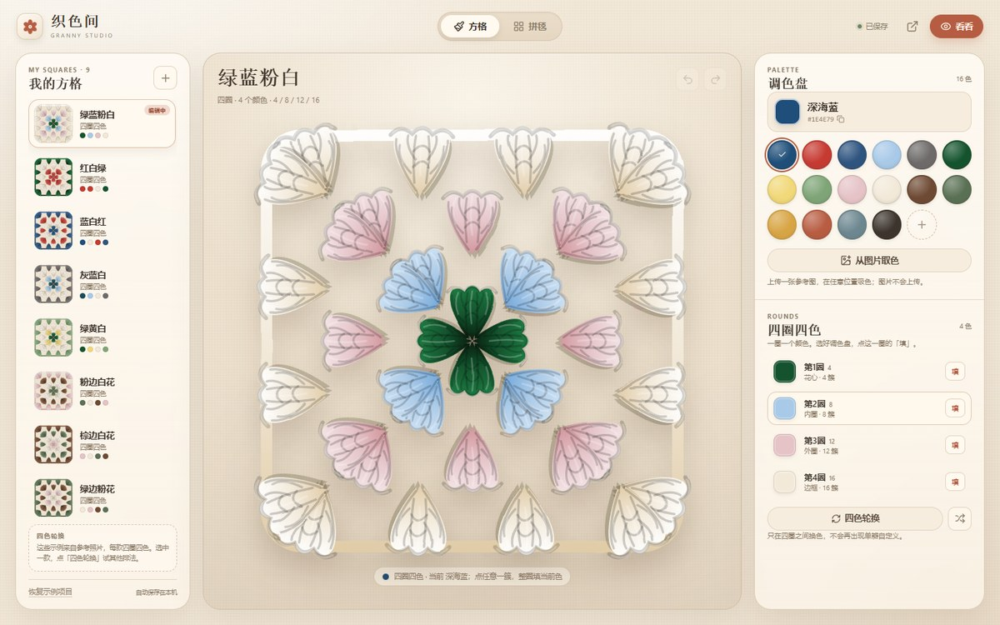
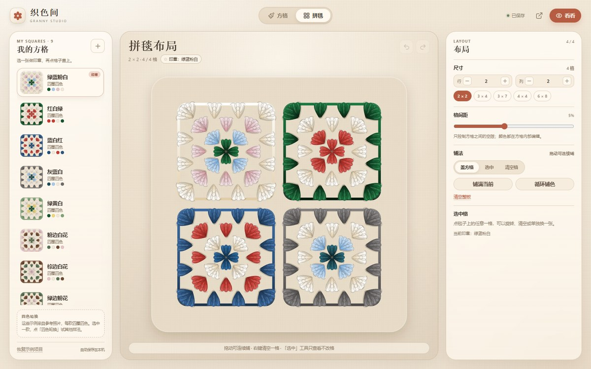
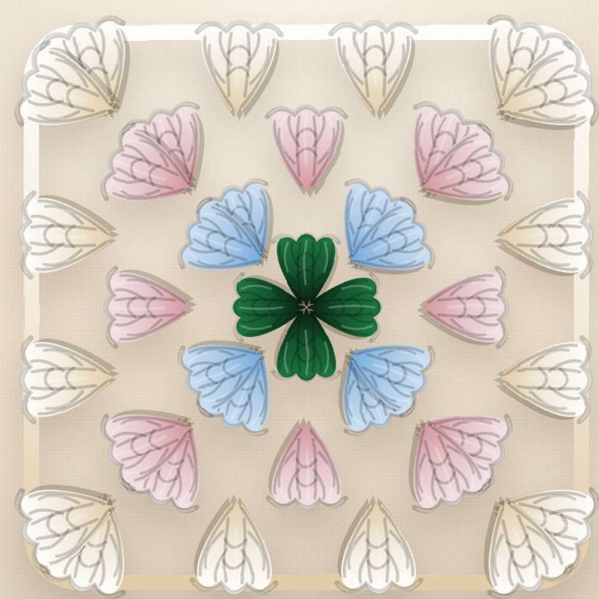
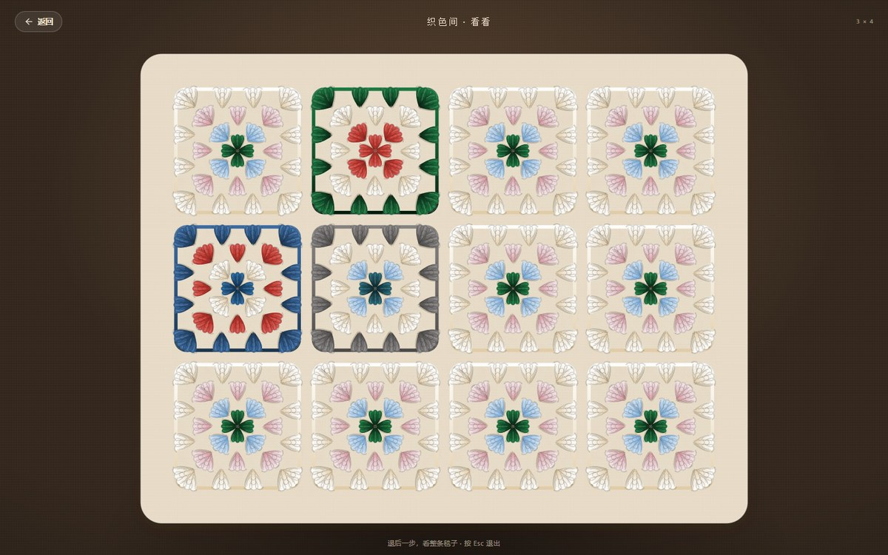
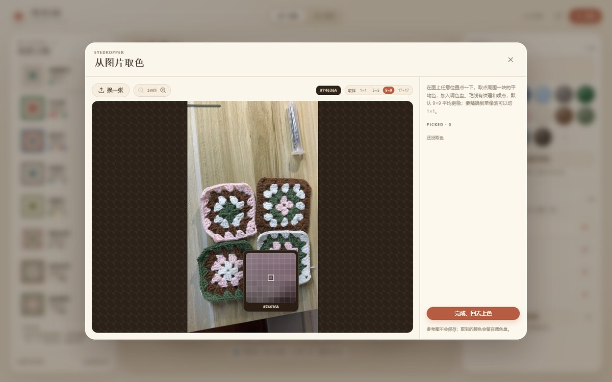
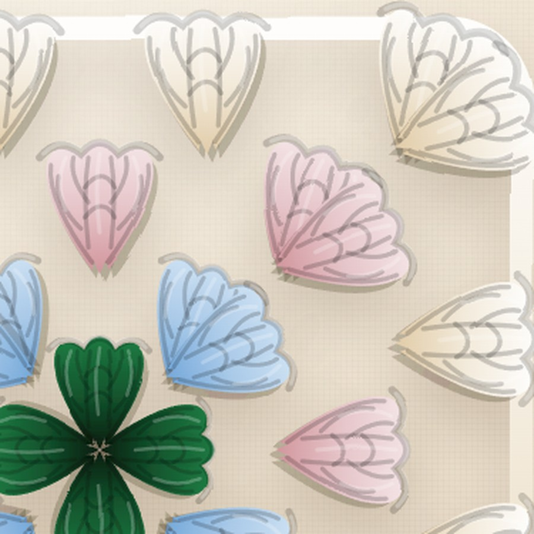

# 织色间 · Granny Studio

**先把颜色织一遍，再动手。**

[](https://github.com/GOODDAYDAY/granny-studio/actions/workflows/deploy.yml)
**[打开线上版 →](https://gooddayday.github.io/granny-studio/)** · [GitHub 仓库](https://github.com/GOODDAYDAY/granny-studio)

一个纯前端的祖母方格配色沙盘：**四圈四色**，从自己的照片里吸平均色，把方格铺成 3×4 / 3×7 的毯子，退后一步看整体。



## 它不是什么

- **不是出图纸工具。** 不做 PNG / PDF 导出，不做线材计算，不做钩织步骤。你只是需要先看一眼，满意了再拿起钩针。
- **不是账号产品。** 没有后端、没有登录、没有云同步。所有数据都在浏览器本地。
- **不是像素画板。** 方格只有四圈：第1圈花心 4 簇、第2圈内圈 8 簇、第3圈外圈 12 簇、第4圈边框 16 簇 + 方框；**一圈一个颜色**，不拆单簇。

## 能做什么

- **四圈四色**：右侧四行分别对应第1–4圈，选一个颜色点「填」；也可以直接点画布上任意一簇或方框，整圈填成当前色。不是单簇上色。
- **九款参考配色**：你发的绿蓝粉白、红白绿，加上蓝白红、灰蓝白、绿黄白，和原来的四款；默认 2×2 铺开。
- **四色轮换**：四个颜色在四圈之间换位，或者随机洗牌。
- **毛线质感**：捻线纹理、针脊、绒边和细颗粒；近看是线，远看是色块。
- **图片取色**：1×1 / 5×5 / 9×9 / 17×17 平均，默认 9×9；点毛线时不会只取到一个噪点。
- **拼毯布局**：2×2、3×4、3×7、4×4、6×8 或自定义；每个格子可引用不同方格、旋转 90°、清空；选中格可「复制一张，只改这一格」。
- **全屏看看**：把整块毯子放到深色台面上，退后一步看。
- **自动保存**：项目存在 localStorage，刷新不丢；撤销 / 重做 60 步。



## 四圈四色

方格只有四圈，一圈一个颜色：

| 圈 | 针法 | 数量 |
| --- | --- | --- |
| 第1圈 | 花心 3 长针簇 | 4 簇 |
| 第2圈 | 内圈 3 长针簇 | 8 簇 |
| 第3圈 | 外圈 3 长针簇 | 12 簇 |
| 第4圈 | 边框 3 长针簇 + 方框 | 16 簇 |

右侧选好调色盘颜色，点对应那一圈的「填」；或者直接点画布上任意一簇、方框的任意一段，整圈就填成当前色。簇与簇之间的空隙露出台面，不做单独背景层；你说的白色就是第2或第3圈，直接给那圈上奶白。

拼毯只负责排布。要让某一格不同：选中格子 →「复制一张，只改这一格」→ 在新方格里改四圈颜色，其它格不受影响。



## 参考照片

你发来的花片和合集，加上原来的参考，一共九款预设：

| 名字 | 第1圈 | 第2圈 | 第3圈 | 第4圈 |
| --- | --- | --- | --- | --- |
| 绿蓝粉白 | 墨绿 | 浅雾蓝 | 藕粉 | 奶白 |
| 红白绿 | 砖红 | 砖红 | 奶白 | 墨绿 |
| 蓝白红 | 深海蓝 | 奶白 | 砖红 | 牛仔蓝 |
| 灰蓝白 | 深青 | 浅雾蓝 | 奶白 | 暖灰 |
| 绿黄白 | 墨绿 | 鹅黄 | 奶白 | 豆绿 |
| 粉边白花 | 鼠尾草绿 | 奶白 | 栗棕 | 藕粉 |
| 棕边白花 | 藕粉 | 奶白 | 鼠尾草绿 | 栗棕 |
| 绿边粉花 | 奶白 | 藕粉 | 栗棕 | 鼠尾草绿 |
| 白边粉花 | 栗棕 | 藕粉 | 鼠尾草绿 | 奶白 |

默认项目是绿蓝粉白、红白绿、蓝白红、灰蓝白铺成 2×2。你发的那张 5×5 合集也是同样的四圈结构：每块四个色，按 中心 / 内圈 / 外圈 / 边框 填进右边四行就能复现。



## 图片取色



点「从图片取色」→ 拖入图片 → 在毛线上点一下，颜色进入调色盘。

取色不再是单像素：默认取点周围 **9×9 像素的平均色**，也可以切成 **5×5 / 17×17** 更柔和，或者 **1×1** 精确取单像素。毛线有纹理、阴影和噪点，平均之后比单点稳得多，这就是照片取色的常规做法。

参考图只在当前页面内存里，不会上传，也不会持久化；取到的颜色会留在项目里。

## 毛线质感

每一簇都是 3 长针，叠了四层：

- 三根向上散开的**长针股线**
- 顶部一排**辫子针锁边**
- 每根针上的**捻线高光 / 暗部**
- 整个方格再叠一圈**绒边**和极细**纤维颗粒**



## 本地运行

```bash
npm install
npm run dev
```

打开 `http://localhost:5173/`。

```bash
npm test        # 领域测试（几何、配色、排版、持久化校验）
npm run build   # 类型检查 + 生产构建
npm run preview # 预览构建产物
```

## 部署

推送到 `main` 后，GitHub Actions 自动跑测试、构建并发布到 GitHub Pages：

**https://gooddayday.github.io/granny-studio/**

工作流在 [`.github/workflows/deploy.yml`](.github/workflows/deploy.yml)。Vite 使用相对 `base`，所以放在项目子路径下也不会坏。

## 项目结构

```text
src/
  domain/       纯 TS，零 React
    geometry.ts   方格的方环几何（4 / 8 / 12 / 16 簇 + 方框）
    patterns.ts   花样结构：4 / 8 / 12 / 16 个区域
    design.ts     四圈四色、旧数据归一化、四色轮换
    board.ts      布局：引用、旋转、缩放、循环铺色
    presets.ts    九款参考配色 + 示例项目
    color.ts      hex / HSL / 命名
  render/       SVG 方格与拼毯（<symbol> + <use> 复用）
  store/        Zustand 状态、撤销重做、localStorage
  components/   方格编辑、拼毯、取色、全屏、弹窗
```

核心拆分是 **Pattern（结构）/ Design（配色）/ Board（引用）**：

- `Pattern` 定义这朵花有哪些区域、每块在哪里。
- `Design` 只存颜色，不知道自己在毯子的哪个位置；界面上收成四圈四色。
- `Board` 只存 `{ designId, rotation }`，不知道方格怎么配色。

所以改一张方格，所有引用它的格子一起变；想让某一格不同，复制一张方格再改。要加新花样，只加一个 pattern 模块，布局和调色盘都不用动。

## 已知取舍

- 方格是**四圈四色的祖母方格**，不是逐针钩织图纸；4 / 8 / 12 / 16 簇的结构按参考图还原，单簇的针数做了视觉归一。
- 不做单簇上色，也没有单独的背景层；白色是某一圈的颜色，空隙露出台面。
- 一个项目只有一张布局板；改行列时，缩小掉的格子不会删除，改回来还在。
- 布局最大 24×24；超过约 150 格时，拼毯会自动简化针脚细节以保证流畅。
- 参考图不持久化；只有取到的颜色、方格和布局会保存。
- 按需求，v1 **不做导出**。

## License

MIT © 2026 GOODDAYDAY
