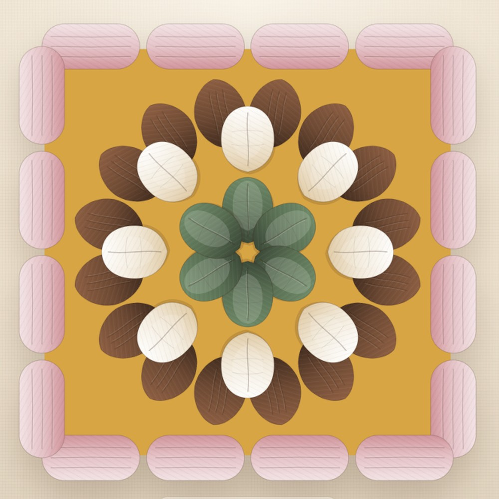

# 织色间 · Granny Studio

**先把颜色织一遍，再动手。**

[](https://github.com/GOODDAYDAY/granny-studio/actions/workflows/deploy.yml)
**[打开线上版 →](https://gooddayday.github.io/granny-studio/)** · [GitHub 仓库](https://github.com/GOODDAYDAY/granny-studio)

一个纯前端的祖母方格配色沙盘：设计六瓣花方格、从自己的图片里吸色、把方格铺成 3×4 / 3×7 的毯子，退后一步看整体效果。


## 它不是什么

- **不是出图纸工具。** 不做 PNG / PDF 导出，不做线材计算，不做钩织步骤。你只是需要先看一眼，满意了再拿起钩针。
- **不是账号产品。** 没有后端、没有登录、没有云同步。所有数据都在浏览器本地。
- **不是像素画板。** 方格是一朵有针法结构的花：6 瓣花心、8 片外瓣、16 组底针、16 组边框。

## 能做什么

- **六瓣花方格**：46 个可上色块，逐块点击；花心 / 外瓣 / 底针 / 边框可以整层填。
- **四色轮换**：把四个颜色在四层之间换位，复现参考照片里的四种配色；还可以随机洗牌。
- **外瓣层序**：里侧 / 外侧一键切换，对应照片里两种不同的层序。
- **图片取色**：上传任意参考图，在图上任意位置吸色；放大镜按原图像素采样。图片不上传，只保留取到的颜色。
- **拼毯布局**：2×2、3×4、3×7、4×4、6×8 或自定义；每个格子可引用不同方格、旋转 90°、清空；选中格可「复制一张，只改这一格」。
- **方格背景**：最外层边框里的白色区域可以填成任意颜色；每张方格一个背景色，拼毯只负责排布。
- **全屏看看**：把整块毯子放到深色台面上，退后一步看。
- **自动保存**：项目存在 localStorage，刷新不丢；撤销 / 重做 60 步。


## 这朵花从哪来

参考照片里的四块花片，其实是**同一组四色**在四层之间的排列实验：

| 花心 6 瓣 | 外瓣 8 片 | 底针 16 组 | 边框 16 组 | 外瓣层序 |
| --- | --- | --- | --- | --- |
| 鼠尾草绿 | 奶白 | 栗棕 | 藕粉 | 里侧 |
| 藕粉 | 奶白 | 鼠尾草绿 | 栗棕 | 外侧 |
| 奶白 | 藕粉 | 栗棕 | 鼠尾草绿 | 里侧 |
| 栗棕 | 藕粉 | 鼠尾草绿 | 奶白 | 外侧 |

默认项目就是这四款，铺成 2×2。选中任意一款，点「四色轮换」继续试。


## 图片取色


点「从图片取色」→ 拖入图片 → 在任意位置点一下，颜色就进入调色盘。放大镜按原图采样，不会取到缩放后的模糊颜色。参考图只在当前页面内存里，不会上传，也不会持久化；取到的颜色会留在项目里。

## 方格背景

最外层边框里的那块白色，就是方格背景。它会把边框以内整片填满；花瓣之间的空隙也是它，不会越过边框跑到外面。

选一个调色盘颜色，直接点边框内的背景，或右侧「方格背景」点「填」。背景色属于这张方格，会跟着方格一起进拼毯。

拼毯只负责排布，不调颜色。要让某一格不同：选中格子 →「复制一张，只改这一格」→ 在新方格里改背景色，其它格不受影响。



## 本地运行

```bash
npm install
npm run dev
```

打开 `http://localhost:5173/`。

```bash
npm test        # 领域测试（几何、配色、排版、持久化校验）
npm run build   # 类型检查 + 生产构建
npm run preview # 预览构建产物
```

## 部署

推送到 `main` 后，GitHub Actions 自动跑测试、构建并发布到 GitHub Pages：

**https://gooddayday.github.io/granny-studio/**

工作流在 [`.github/workflows/deploy.yml`](.github/workflows/deploy.yml)。Vite 使用相对 `base`，所以放在项目子路径下也不会坏。

## 项目结构

```text
src/
  domain/       纯 TS，零 React
    geometry.ts   方格的区域几何（花瓣、外瓣、底针、边框）
    patterns.ts   花样结构：6 / 8 / 16 / 16 个区域
    design.ts     方格配色：单块上色、整层填色、方格背景、四色轮换
    board.ts      布局：引用、旋转、缩放、循环铺色
    presets.ts    四款参考配色 + 示例项目
    color.ts      hex / HSL / 命名
  render/       SVG 方格与拼毯（<symbol> + <use> 复用）
  store/        Zustand 状态、撤销重做、localStorage
  components/   方格编辑、拼毯、取色、全屏、弹窗
```

核心拆分是 **Pattern（结构）/ Design（配色）/ Board（引用）**：

- `Pattern` 定义这朵花有哪些区域、每块在哪里。
- `Design` 只存每个区域的颜色，不知道自己在毯子的哪个位置。
- `Board` 只存 `{ designId, rotation }`，不知道方格怎么配色。

所以改一张方格，所有引用它的格子一起变；想让某一格不同，复制一张方格再改。要加新花样，只加一个 pattern 模块，布局和调色盘都不用动。

## 已知取舍

- 方格是**配色用的风格化花片**，不是逐针钩织图纸；比例按参考照片还原，针数做了视觉归一。
- 一个项目只有一张布局板；改行列时，缩小掉的格子不会删除，改回来还在。
- 背景色属于方格对象，不是毯子布局的属性；每格要不同，就复制一张方格再改。
- 按需求，v1 **不做导出**。
- 布局最大 24×24；超过约 150 格时，拼毯会自动简化针脚细节以保证流畅。
- 参考图不持久化；只有取到的颜色、方格和布局会保存。

## License

MIT © 2026 GOODDAYDAY
